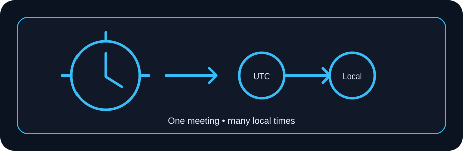

Convert a meeting date and time across IANA time zones, showing UTC offsets and day changes with daylight-saving support.

   

## 🎯 Overview

TZ Grid converts one local meeting time into several target time zones using Python's IANA timezone database. It shows each local date, time, UTC offset, and whether the conversion lands on the previous or next day. Daylight-saving transitions are handled by zoneinfo.

## ✨ Features

- 🌍 Converts one source time into multiple target zones.
- 🕰️ Uses IANA timezone names such as Europe/Berlin and Asia/Tehran.
- 📆 Shows date changes across time zones.
- ☀️ Applies daylight-saving offsets for the selected date.
- ⚠️ Detects nonexistent local times and explains ambiguous ones.

## 🎬 Demo

<pre><code>python main.py --date 2026-11-16 --time 09:00 --from-zone Asia/Tehran --to-zones Europe/Berlin,America/New_York,Asia/Tokyo</code></pre>

## 🚀 Quick Start

<pre><code>python main.py --date YYYY-MM-DD --time HH:MM --from-zone Asia/Tehran --to-zones Europe/Berlin,America/New_York</code></pre>

## 🧰 Tech Stack

- Python 3.10+ standard library
- zoneinfo and datetime
- IANA timezone database available on the host system

## 🗂️ Folder Structure

<pre><code>tz-grid/
├── main.py
├── requirements.txt
└── assets/
    └── illustration.svg</code></pre>

## 🧭 Roadmap

- [ ] Add a multi-date weekly meeting grid.
- [ ] Add CSV output for sharing with teams.
- [ ] Add a small interactive local web view.

## 🤝 Contributing

Issues and pull requests are welcome. Include the source date, time, timezone names, and expected conversion when reporting a bug.

## 📄 License

Released under the MIT License. See [LICENSE](LICENSE).

